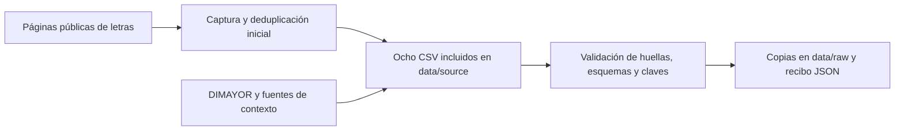

# Definición y trazabilidad de los datos

[Inicio](../../README.md) · [Marco del proyecto](../business_understanding/project_charter.md) · [Diccionarios](data_dictionary.md) · [Cargador](../../scripts/data_acquisition/main.py)

> [!NOTE]
> **Corte documental del 1 de septiembre de 2026.** El universo de referencia cubre 20 clubes de Primera A. En las fuentes revisadas se localizaron letras para 17 clubes. Cada fila del corpus conserva la letra transcrita y su URL de procedencia. Los ocho archivos del corte `fase1-2026-09-01` están incluidos en este repositorio. [Datos de entrada](../../data/source/) · [Manifiesto](../../scripts/data_acquisition/manifest.json)

## Procedencia del corpus

La adquisición inicial seleccionó páginas públicas con letras y una relación identificable con los clubes de interés. Se registraron títulos, transcripciones, direcciones de publicación y contexto editorial cuando aportaba información comprobable. De **610 capturas**, la integración eliminó **10 coincidencias canónicas exactas** dentro de un mismo club y conservó **600 registros**. Los casos de similitud, segmentación o asociación quedaron marcados para revisión. [Fuentes revisadas](../../data/source/fuentes_revisadas.csv) · [Bitácora de duplicados exactos](../../data/source/duplicados_exactos.csv)

| Procedencia de las letras | Registros | Porcentaje sobre 600 | Consideración |
| --- | ---: | ---: | --- |
| Barrabrava.net | 388 | 64,7 % | Principal fuente del corpus. |
| FanChants | 176 | 29,3 % | Algunas páginas aportan contexto editorial. |
| Attake Massivo Pasto & La Banda Tricolor | 18 | 3,0 % | Los bloques proceden de una página con varias letras. |
| Fortaleza Leoparda (4mg) | 18 | 3,0 % | El sitio está asociado con Atlético Bucaramanga. |

DIMAYOR delimita el universo de referencia. El catálogo de clubes reúne el desempeño entre 2021-II y 2026-I, la asistencia observada en 2025 y los seguidores de Instagram al corte. Las columnas `ref_*` identifican qué referencia respalda cada familia de atributos. [Reglamento de Liga BetPlay 2026](https://dimayor.com.co/wp-content/uploads/2026/01/REGLAMENTO-LIGA-2026-V11-1.pdf) · [Inventario bibliográfico](../../data/source/bibliografia_apa7.csv)



## Archivos incluidos

Cada archivo tiene cabecera y separador de comas. Los ocho están codificados en UTF-8 con BOM. `letra_original` admite saltos de línea dentro de un solo campo CSV entrecomillado. Los diccionarios detallan el tipo lógico, el significado y los faltantes de cada campo. [Diccionarios de datos](data_dictionary.md)

| Archivo | Filas × columnas | Función en la entrega |
| --- | ---: | --- |
| [`canticos.csv`](../../data/source/canticos.csv) | 600 × 19 | Corpus de adquisición. |
| [`clubes.csv`](../../data/source/clubes.csv) | 20 × 30 | Universo 2026 y variables de contexto. |
| [`control_cobertura.csv`](../../data/source/control_cobertura.csv) | 20 × 8 | Cobertura y conciliación del conteo por club. |
| [`duplicados_exactos.csv`](../../data/source/duplicados_exactos.csv) | 10 × 8 | Trazabilidad de las coincidencias exactas excluidas en la adquisición. |
| [`fuentes_revisadas.csv`](../../data/source/fuentes_revisadas.csv) | 31 × 8 | Páginas candidatas de las fuentes adicionales y decisiones de inclusión. |
| [`cambios_identidad_clubes.csv`](../../data/source/cambios_identidad_clubes.csv) | 2 × 8 | Correspondencia de identidades históricas con el universo 2026. |
| [`bibliografia_apa7.csv`](../../data/source/bibliografia_apa7.csv) | 75 × 6 | Referencias, fechas de consulta y datos respaldados. |
| [`decisiones_revision_fase2.csv`](../../data/source/decisiones_revision_fase2.csv) | 57 × 14 | Bitácora de decisiones disponible para la fase de preprocesamiento. |

## Carga y validación

Desde la raíz del repositorio, ejecuta el cargador con Python 3.11 o posterior. Usa la biblioteca estándar y lee los archivos locales, por lo que puede ejecutarse sin conexión.

```bash
python3 scripts/data_acquisition/main.py
```

| Elemento | Ruta o regla |
| --- | --- |
| Punto de entrada | [`scripts/data_acquisition/main.py`](../../scripts/data_acquisition/main.py) |
| Contrato de entrada | [`manifest.json`](../../scripts/data_acquisition/manifest.json), con versión del corte, huellas SHA-256, tamaños, cabeceras y conteos esperados. |
| Entrada predeterminada | [`data/source/`](../../data/source/), que contiene los ocho CSV incluidos en el repositorio. |
| Entrada alternativa | Una carpeta local con los mismos ocho archivos mediante `--origen-local`. Se aplica el mismo contrato. |
| Copias verificadas | `data/raw/<archivo>.csv`, con los bytes de la entrada. |
| Recibo de ejecución | `data/carga_fase1.json`, con dimensiones, huellas y controles agregados. |

La carga verifica las ocho huellas, cabeceras y dimensiones. Comprueba los identificadores, la procedencia y la fecha de consulta de los cánticos, y concilia las claves `club_id` con el catálogo y la cobertura. Las copias de `data/raw/` y el recibo son resultados locales excluidos de Git.

> [!IMPORTANT]
> `letra_original` es evidencia documental. La limpieza y las decisiones de curaduría se aplicarán sobre una versión de trabajo derivada. Cada texto conserva su URL y fecha de consulta.

## Evidencia del corte

| Control | Resultado esperado del corte incluido |
| --- | --- |
| Huellas, cabeceras y dimensiones | **8 de 8** CSV cumplen el manifiesto. |
| Identificadores y procedencia | **600** IDs y **600** URL únicas en el corpus. |
| Integración con clubes | **600 de 600** cánticos con `club_id` válido. La cobertura concilia en los **20** clubes de referencia. |
| Texto y cobertura | **33.077** palabras declaradas y **17 de 20** clubes con registros. |
| Banderas de calidad | **88** registros para revisión de similitud (67), segmentación (18) o asociación (3). |
| Sin letras localizadas | Águilas Doradas, Fortaleza CEIF y Llaneros FC. |

<details>
<summary>Cómo interpretar la cobertura y las banderas</summary>

- La proporción `17/20` mide presencia en la recopilación. La frecuencia de cada club depende del material digital disponible y de las fuentes consultadas.
- Las 88 banderas preservan observaciones para la curaduría. El corpus adquirido conserva los registros marcados.
- Una frecuencia igual a cero describe la disponibilidad de textos en el corte. El catálogo preserva las filas de los clubes sin letras localizadas.

</details>
