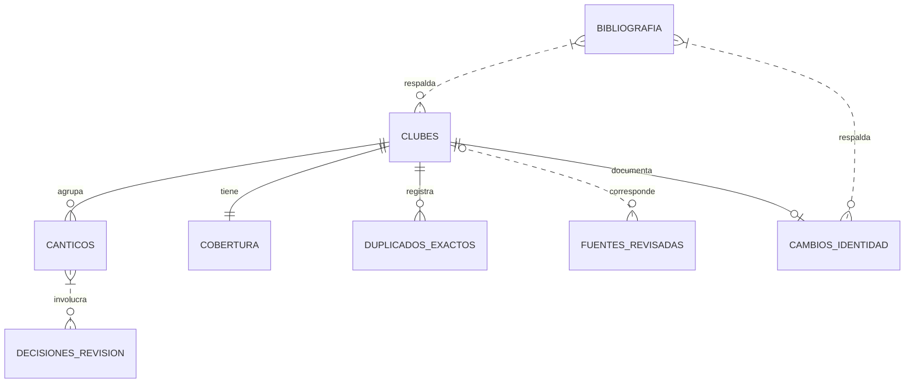

# Diccionario de datos

[Inicio](../../README.md) · [Marco del proyecto](../business_understanding/project_charter.md) · [Definición de datos](data_definition.md)

**Corpus auditable de cánticos del fútbol profesional colombiano**

**Corte de adquisición** 1 de septiembre de 2026 · **Versión del conjunto** `fase1-2026-09-01`

El corpus de entrada contiene **600 registros publicados asociados con 17 de los 20 clubes** del universo de referencia. Las tablas auxiliares permiten reconstruir la cobertura localizada, vincular el contexto de los clubes y auditar decisiones. El archivo de decisiones se carga como referencia histórica para la Fase 2. [Datos incluidos en el repositorio](../../data/source/) · [Manifiesto de integridad](../../scripts/data_acquisition/manifest.json)

> [!NOTE]
> Los rangos y conteos de esta página describen el corte verificado. Los identificadores `CAN`, `CLU` y `REF` identifican registros del corpus, clubes y referencias. Los ocho archivos se leen como CSV con encabezado, coma y codificación `UTF-8` con BOM. Una celda vacía representa ausencia del dato. Los tipos lógicos distinguen texto, entero, decimal, fecha ISO `AAAA-MM-DD`, año `AAAA`, categoría, URL y lista serializada.

## Inventario

| Tabla | Filas × campos | Unidad de registro | Identificación |
| --- | ---: | --- | --- |
| [Cánticos](#cánticos) | 600 × 19 | Registro de una letra publicada, después de deduplicación canónica exacta | `cantico_id`, único |
| [Clubes](#clubes) | 20 × 30 | Club del universo Liga BetPlay A 2026 | `club_id`, único |
| [Control de cobertura](#control-de-cobertura) | 20 × 8 | Conteos y estado por club | `club_id`, único |
| [Duplicados exactos](#duplicados-exactos) | 10 × 8 | Captura descartada y su versión conservada | `url_descartada`, única en este corte |
| [Fuentes revisadas](#fuentes-revisadas) | 31 × 8 | Página candidata del lote de fuentes adicionales | `url`, única en este corte |
| [Cambios de identidad](#cambios-de-identidad) | 2 × 8 | Equivalencia de identidad histórica y club actual | `club_id`, único en este corte |
| [Bibliografía](#bibliografía) | 75 × 6 | Referencia que respalda datos y decisiones | `ref_id`, único |
| [Decisiones de revisión](#decisiones-de-revisión) | 57 × 14 | Decisión histórica de curaduría para la Fase 2 | `revision_id`, único |

## Cómo se conectan

- Para contextualizar los cánticos, une `canticos.club_id` con `clubes.club_id` en una relación de muchos a uno. Para mostrar clubes con cero textos, parte de `clubes` o de `control_cobertura`.
- Las listas de referencias `REF` se separan por `;`. Las de cánticos `CAN` en `posible_similar_a` y `canticos_involucrados` se separan por `|`. Quita espacios al separar elementos y valida cada clave antes de unir.
- En duplicados, `(club_id, url_conservada)` identifica el registro que permanece en `canticos`. La URL descartada se conserva como evidencia de la captura retirada.
- La fase de carga preserva el texto, las etiquetas y las decisiones del corte. Las variables que se produzcan luego para inferencia y evaluación se documentarán con sus transformaciones.

## Cánticos

**Granularidad** una fila por registro incluido en el corte, con o sin bandera de revisión. **Clave primaria** `cantico_id`. **Clave foránea** `club_id` → `clubes.club_id`. Hay 88 filas con marca de revisión y 600 letras y URLs distintas en este corte. [CSV de cánticos](../../data/source/canticos.csv)

Ver 19 campos de los cánticos

| Campo | Definición | Tipo lógico | Valores y faltantes observados | Procedencia |
| --- | --- | --- | --- | --- |
| `cantico_id` | Identificador estable de esta versión del registro | Texto | `CAN0001`–`CAN0600`, único y completo | Constructor del corpus |
| `club_id` | Club asociado en el momento de adquisición | Texto | 17 claves válidas, sin vacíos | Integración contra el catálogo de clubes |
| `equipo_mencionado_fuente` | Nombre que aparece en la fuente, incluso si es histórico | Texto | 19 etiquetas distintas, sin vacíos | Publicación original |
| `titulo_referencia` | Título de referencia publicado | Texto | 582 títulos distintos, sin vacíos. Puede repetirse y sirve para localizar la fuente | Publicación original |
| `letra_original` | Transcripción recopilada, con sus grafías y saltos de línea | Texto multilínea | 600 letras no vacías. Se preserva como evidencia primaria | Publicación original |
| `contexto_cantico` | Nota editorial que aporta desambiguación o un hecho comprobable | Texto | 5 presentes, 595 vacías | Selección de contexto de FanChants y fuentes de contraste |
| `referente_contextual` | Referente señalado en la nota editorial | Texto | 5 presentes, 595 vacíos. Uno queda sin desambiguar | Contexto de la fuente y verificación documental |
| `fuente_contexto` | Enlace documental que sustenta el contexto | URL | 4 presentes, 596 vacías | Sitios oficiales de clubes y prensa |
| `estado_contexto` | Grado de resolución de la referencia editorial | Categoría | 4 `verificado con fuente externa`, 1 `referente no desambiguado`, 595 vacíos | Control editorial |
| `fuente` | Sitio del que se recuperó la transcripción | Categoría | Barrabrava.net 388, FanChants 176, Blog Attake Massivo Pasto & La Banda Tricolor 18, Fortaleza Leoparda (4mg) 18 | Registro de adquisición |
| `url` | Enlace a la publicación o bloque de la letra | URL | 600 distintas, 582 HTTPS y 18 HTTP. Algunos enlaces contienen un fragmento | Registro de adquisición |
| `fecha_consulta` | Fecha de recuperación documentada | Fecha ISO | `2026-09-01` en las 600 filas | Registro de adquisición |
| `fecha_publicacion` | Año de publicación informado por el sitio | Año | 151 valores de FanChants entre 2012 y 2021, 449 vacíos. La precisión disponible es anual | Publicación original |
| `metodo_adquisicion` | Procedimiento de captura registrado | Categoría | `Copiado de texto público mediante extracción reproducible` en las 600 filas | Registro de adquisición |
| `numero_palabras` | Conteo del constructor que conserva números y grafías internas | Entero | 4–695 por registro, total 33.077, sin vacíos | Cálculo sobre `letra_original` |
| `estado_verificacion` | Resultado del control inicial de calidad | Categoría | `aceptado` 512, `requiere revisión: asociación con club` 3, `requiere revisión: similitud` 67, `requiere revisión: segmentación de fuente` 18 | Controles de adquisición |
| `posible_similar_a` | Identificadores de candidatos con similitud alta dentro de un club | Lista de textos `CAN` | 71 listas presentes, 529 vacías. Se conservan los candidatos para revisión | Comparación de secuencia, vocabulario y longitud |
| `revision_manual` | Indicador de que la adquisición dejó un caso por revisar | Categoría booleana | `Sí` 88, `No` 512 | Controles de adquisición |
| `observacion_revision` | Nota sobre asociación, similitud, segmentación o duplicación de la captura | Texto | 96 presentes, 504 vacías. Puede existir en filas aceptadas | Constructor y control de fuente |

## Clubes

**Granularidad** un club de la Liga BetPlay A 2026. **Clave primaria** `club_id`. Las medidas de rendimiento, asistencia y seguidores corresponden a cortes distintos. Los campos `ref_*` permiten consultar el respaldo específico en el inventario bibliográfico. [CSV de clubes](../../data/source/clubes.csv)

Ver 30 campos de los clubes

| Campo | Definición | Tipo lógico | Valores y faltantes observados | Procedencia |
| --- | --- | --- | --- | --- |
| `club_id` | Identificador canónico del club para este estudio | Texto | `CLU001`–`CLU020`, único y completo | Catálogo del proyecto |
| `nombre_oficial` | Nombre institucional usado en el catálogo | Texto | 20 distintos, sin vacíos | Fichas de clubes y referencias del universo |
| `nombre_corto` | Nombre de presentación | Texto | 20 distintos, sin vacíos | Catálogo a partir de las fichas |
| `ciudad_sede` | Ciudad de la sede registrada del club | Texto | 15 ciudades, sin vacíos | Fichas de clubes |
| `departamento` | Departamento o distrito de la sede | Texto | 14 valores, sin vacíos | Contexto geográfico de la sede |
| `region` | Agrupación territorial de la sede | Categoría | Andina 13 clubes, Caribe 3, Pacífica 3, Orinoquía 1 | Clasificación geográfica del proyecto |
| `anio_fundacion` | Año de fundación según la identidad registrada | Año | 1912–2024, sin vacíos | Fichas de clubes y referencias de identidad |
| `estadio_principal` | Estadio principal consignado en el catálogo | Texto | 17 valores, sin vacíos | Fichas de clubes |
| `participa_liga_a_2026` | Pertenencia al universo de referencia | Categoría booleana | `Sí` para los 20 clubes | DIMAYOR, `REF001` |
| `titulos_liga_hasta_2026_I` | Títulos en Primera A acumulados hasta 2026-I | Entero | 0–18, sin vacíos | RSSSF, resumen histórico y DIMAYOR, `REF002`–`REF004` |
| `subcampeonatos_liga_hasta_2026_I` | Subcampeonatos en Primera A hasta 2026-I | Entero | 0–14, sin vacíos | RSSSF, resumen histórico y DIMAYOR, `REF002`–`REF004` |
| `periodo_rendimiento` | Ventana de las variables de rendimiento reciente | Texto | `2021-II a 2026-I` en los 20 clubes | Tablas por torneo, `REF005`–`REF014` |
| `torneos_disputados_periodo` | Torneos de Primera A en los que participó el club durante la ventana | Entero | 1–10, sin vacíos | Tablas por torneo, `REF005`–`REF014` |
| `clasificaciones_fase_final_periodo` | Torneos disputados en los que el club terminó entre los ocho primeros de la primera fase | Entero | 0–9, nunca superior a los torneos disputados | Tablas por torneo, `REF005`–`REF014` |
| `tasa_clasificacion` | Clasificaciones divididas por torneos disputados en la ventana | Decimal | 0–0,9 observado. Proporción en escala 0–1 | Cálculo del proyecto sobre `REF005`–`REF014` |
| `promedio_asistencia_2025` | Promedio reportado para partidos de local con dato en Primera A 2025 | Entero, personas por partido | 1.600–29.701 en 18 clubes. Vacío en Cúcuta Deportivo y Jaguares de Córdoba | FBref, `REF015` |
| `partidos_con_dato_asistencia` | Partidos de local que sustentan el promedio | Entero | 0–27, sin vacíos. Los dos ceros indican ausencia de partidos con dato | FBref, `REF015` |
| `nombre_en_fuente_asistencia` | Nombre usado por FBref o estado de participación en 2025 | Texto | Sin vacíos. Dos valores son `No disputó Primera A 2025` | FBref y contraste de participación |
| `instagram_oficial` | Identificador del perfil institucional usado para la consulta | Texto | 20 valores distintos, sin vacíos | Perfiles de clubes, `REF021`–`REF040` |
| `seguidores_instagram` | Conversión numérica aproximada de la cifra visible | Entero, seguidores | 44.000–2.000.000, sin vacíos | Perfiles de clubes, `REF021`–`REF040` |
| `seguidores_instagram_texto_fuente` | Cifra abreviada tal como se registró | Texto | 20 valores, con sufijos de escala, sin vacíos | Perfiles de clubes, `REF021`–`REF040` |
| `precision_seguidores` | Advertencia sobre la precisión de la cifra visible | Categoría | `Aproximado: Instagram muestra una cifra abreviada` en 20 filas | Plataforma y registro del proyecto |
| `fecha_corte_seguidores` | Fecha del corte de seguidores | Fecha ISO | `2026-09-01` en 20 filas | Registro de consulta |
| `fuente_instagram` | Enlace al perfil institucional consultado | URL | 20 distintos, sin vacíos | Perfiles de clubes |
| `ref_universo` | Referencias que respaldan pertenencia e identidad | Lista de textos `REF` | 20 listas completas. Incluye `REF001` y referencias complementarias según el club | `bibliografia_apa7.ref_id` |
| `ref_palmares` | Referencias de títulos y subcampeonatos | Lista de textos `REF` | `REF002; REF003; REF004` en 20 filas | `bibliografia_apa7.ref_id` |
| `ref_rendimiento` | Referencias torneo por torneo | Lista de textos `REF` | `REF005`–`REF014` en 20 filas | `bibliografia_apa7.ref_id` |
| `ref_asistencia` | Referencia de asistencia | Texto `REF` | `REF015` en 20 filas | `bibliografia_apa7.ref_id` |
| `ref_instagram` | Referencia del perfil institucional | Texto `REF` | `REF021`–`REF040`, una por club | `bibliografia_apa7.ref_id` |
| `observaciones_datos_club` | Nota de continuidad institucional o ausencia de asistencia | Texto | 4 presentes, 16 vacías | Control editorial a partir de fuentes |

## Control de cobertura

**Granularidad** un club, con o sin textos localizados. **Clave primaria y foránea** `club_id` → `clubes.club_id`. El total después de deduplicar es 600 y coincide con el recuento de cánticos de los 20 clubes. [CSV de cobertura](../../data/source/control_cobertura.csv)

Ver 8 campos del control de cobertura

| Campo | Definición | Tipo lógico | Valores y faltantes observados | Procedencia |
| --- | --- | --- | --- | --- |
| `club_id` | Club al que corresponde el recuento | Texto | 20 claves únicas y completas | Catálogo de clubes |
| `nombre_corto` | Etiqueta de presentación del club | Texto | 20 distintas, sin vacíos | `clubes.nombre_corto` |
| `fanchants_total_declarado` | Tamaño del inventario FanChants registrado antes de deduplicar | Entero | 0–42 por club, total 177 | Páginas de inventario FanChants |
| `fanchants_recuperados` | Filas conservadas con procedencia FanChants | Entero | 0–41 por club, total 176 | Corpus integrado |
| `barrabrava_recuperados` | Filas conservadas con procedencia Barrabrava.net | Entero | 0–93 por club, total 388 | Corpus integrado |
| `registros_finales` | Filas del corpus adquirido tras deduplicación exacta, incluidas otras fuentes | Entero | 0–124 por club, total 600 | Corpus integrado |
| `estado_primera_pasada` | Clasificación heredada sobre disponibilidad digital | Categoría | 3 sin letra localizada, 8 de otra fuente sin FanChants, 8 cobertura FanChants completa y 1 marcada como parcial | Reglas del control inicial |
| `interpretacion` | Texto que delimita el significado del conteo | Texto | `Cobertura digital localizada; cero no equivale a ausencia de repertorio.` en 20 filas | Nota metodológica |

El estado parcial corresponde a Atlético Nacional. Se localizaron 42 capturas FanChants. Después de retirar una coincidencia canónica con una fila de Barrabrava.net quedaron 41 en la cuenta de FanChants. [Bitácora de duplicados](../../data/source/duplicados_exactos.csv)

## Duplicados exactos

**Granularidad** una captura descartada en la integración. Identificador observado `url_descartada`, verificable contra la bitácora completa. Una captura se clasifica como duplicada al coincidir la secuencia canónica completa dentro del mismo club. [CSV de duplicados exactos](../../data/source/duplicados_exactos.csv)

Ver 8 campos de la bitácora de duplicados

| Campo | Definición | Tipo lógico | Valores y faltantes observados | Procedencia |
| --- | --- | --- | --- | --- |
| `club_id` | Club de ambas capturas | Texto | 6 claves válidas, sin vacíos | Catálogo y comparación por club |
| `titulo_conservado` | Título de la captura retenida | Texto | 10 presentes | Captura conservada |
| `fuente_conservada` | Sitio de la captura retenida | Categoría | Barrabrava.net en 10 filas | Captura conservada |
| `url_conservada` | URL que permanece en el corpus | URL | 10 presentes y resuelven en `canticos.url` | Captura conservada |
| `titulo_descartado` | Título de la captura retirada | Texto | 10 presentes | Captura descartada |
| `fuente_descartada` | Sitio de la captura retirada | Categoría | Barrabrava.net 8, FanChants 1, blog de Pasto 1 | Captura descartada |
| `url_descartada` | URL excluida del corpus integrado | URL | 10 únicas, ninguna aparece en `canticos.url` | Captura descartada |
| `regla` | Criterio aplicado para retirar la captura | Categoría | `secuencia canónica completa idéntica dentro del mismo club` en 10 filas | Constructor del corpus |

## Fuentes revisadas

**Granularidad** una página candidata del lote de fuentes adicionales. La bitácora contiene 25 páginas incluidas, 6 excluidas y 433 registros recuperados antes de deduplicar. Los lotes de FanChants se registraron por separado. [CSV de fuentes revisadas](../../data/source/fuentes_revisadas.csv)

Ver 8 campos de la bitácora de fuentes

| Campo | Definición | Tipo lógico | Valores y faltantes observados | Procedencia |
| --- | --- | --- | --- | --- |
| `url` | Enlace a la página candidata | URL | 31 únicas y completas | Inventario de consulta |
| `club_id` | Club al que se vincula la página incluida | Texto | 25 presentes para 17 clubes, 6 vacías en páginas excluidas | Catálogo y decisión de inclusión |
| `equipo_fuente` | Nombre del equipo que aparece en el sitio | Texto | 23 distintos, sin vacíos | Página candidata |
| `decision` | Resultado de selección de la página | Categoría | `incluir` 21, `excluir` 6, `incluir_continuidad` 2, `incluir_especial` 2 | Protocolo de adquisición |
| `motivo` | Justificación de la selección | Texto | 7 valores, sin vacíos | Protocolo y bitácora de adquisición |
| `enlaces_letra` | Cantidad de enlaces o bloques de letras identificados | Entero | 0–97 por página, total 433 | Inventario de consulta |
| `recuperados` | Cantidad de registros recuperados antes de integración | Entero | 0–97 por página, total 433 | Registro de captura |
| `errores` | Cantidad de errores registrados durante esa recuperación | Entero | 0 en las 31 páginas del lote | Registro de captura |

## Cambios de identidad

**Granularidad** una equivalencia documentada entre identidad histórica y club actual. **Clave primaria y foránea** `club_id` → `clubes.club_id`. Las equivalencias respaldan la unión por club y preservan el nombre publicado en `equipo_mencionado_fuente`. [CSV de cambios de identidad](../../data/source/cambios_identidad_clubes.csv)

Ver 8 campos de continuidad institucional

| Campo | Definición | Tipo lógico | Valores y faltantes observados | Procedencia |
| --- | --- | --- | --- | --- |
| `club_id` | Clave canónica de la identidad actual | Texto | `CLU002` y `CLU015`, sin vacíos | Catálogo del proyecto |
| `club_actual_2026` | Nombre oficial o denominación actual registrada | Texto | Alianza FC / Alianza Valledupar FC e Internacional de Bogotá | DIMAYOR y anuncio del club |
| `identidad_historica_en_fuente` | Nombre conservado en las páginas de cánticos | Texto | Alianza Petrolera y La Equidad | Sitios de cánticos |
| `cambio_documentado` | Hecho, fecha y condiciones de la continuidad | Texto | Dos notas, una por club | DIMAYOR y anuncio del club |
| `tratamiento_en_corpus` | Regla de integración y preservación del nombre histórico | Texto | Dos notas, una por club | Decisión metodológica |
| `canticos_identidad_historica` | Registros adquiridos bajo el nombre anterior | Entero | 1 para Alianza Petrolera, 15 para La Equidad | Corpus integrado |
| `canticos_identidad_actual` | Registros adquiridos bajo el nombre actual | Entero | 0 para ambos clubes | Corpus integrado |
| `fuentes` | Referencias bibliográficas del cambio de identidad | Lista de textos `REF` | `REF020; REF071` y `REF016; REF075` | `bibliografia_apa7.ref_id` |

## Bibliografía

**Granularidad** una referencia documental. **Clave primaria** `ref_id`. Incluye las fuentes que respaldan variables de clubes, asociaciones históricas y decisiones de adquisición. [CSV de bibliografía](../../data/source/bibliografia_apa7.csv)

Ver 6 campos de la bibliografía

| Campo | Definición | Tipo lógico | Valores y faltantes observados | Procedencia |
| --- | --- | --- | --- | --- |
| `ref_id` | Identificador de la referencia documental | Texto | `REF001`–`REF075`, único y completo | Catálogo bibliográfico |
| `referencia_apa7` | Referencia formateada para citación | Texto | 75 presentes, 69 textos distintos | Fuente y registro bibliográfico |
| `url` | Enlace a la evidencia documental | URL | 75 únicos, 74 HTTPS y 1 HTTP | Fuente documentada |
| `fecha_consulta` | Fecha registrada de consulta | Fecha ISO | `2026-09-01` en 75 filas | Registro del proyecto |
| `datos_respaldados` | Atributo, decisión o dato sustentado por la referencia | Texto | 18 descripciones distintas, sin vacíos | Matriz de procedencia |
| `notas` | Aclaración de uso, cálculo, decisión o grado de precisión | Texto | 53 presentes, 22 vacías | Control editorial |

## Decisiones de revisión

**Granularidad** una decisión documentada tras revisar las fuentes del corte inicial. **Clave primaria** `revision_id`. Las claves de cántico remiten al corpus adquirido y la clave de club corregida al catálogo. El archivo conserva las decisiones y sus evidencias para aplicarlas al corpus en la Fase 2. [CSV de decisiones de revisión](../../data/source/decisiones_revision_fase2.csv)

Ver 14 campos de las decisiones históricas

| Campo | Definición | Tipo lógico | Valores y faltantes observados | Procedencia |
| --- | --- | --- | --- | --- |
| `revision_id` | Identificador de un caso revisado | Texto | 57 únicos, con prefijos `SIM-`, `SEG-` y `ASO-` | Bitácora de curaduría |
| `tipo_revision` | Aspecto evaluado en la revisión | Categoría | `similitud` 35, `segmentacion` 18, `asociacion` 4 | Clasificación de casos |
| `canticos_involucrados` | Cántico o par documentado en la decisión | Lista de textos `CAN` | 57 listas completas, separadas por `\|` cuando hay dos IDs | Corpus adquirido y bitácora |
| `decision_revision` | Acción decidida sobre el caso | Categoría | `conservar_uno` 33, `conservar_ambos` 2, `segmentacion_correcta` 18, `confirmar_club` 3, `reasignar_club` 1 | Revisión de fuentes |
| `id_conservar_o_relacionar` | Clave de la versión que se conserva o relaciona en la decisión | Texto `CAN` | 33 presentes, 24 vacías | Revisión de similitud |
| `club_id_corregido` | Clave de destino cuando procede una reasignación | Texto `CLU` | 1 presente, 56 vacías | Revisión de asociación |
| `nombre_club_corregido` | Nombre del club de destino de la reasignación | Texto | 1 presente, 56 vacías | Catálogo y revisión de asociación |
| `justificacion` | Motivo documentado de la acción | Texto | 57 presentes | Revisión de fuentes |
| `revisor` | Nombre consignado de la persona revisora | Texto | 57 presentes. La documentación omite el valor nominal | Bitácora de curaduría |
| `fecha_revision` | Fecha individual de la revisión cuando se documenta | Fecha ISO prevista | 57 vacías. La fecha de integración es un campo distinto | Bitácora de curaduría |
| `fecha_integracion` | Fecha registrada de consolidación de la bitácora | Fecha ISO | `2026-09-07` en 57 filas | Registro de integración |
| `urls_evidencia` | Enlaces a las páginas que sustentan el caso | Lista de URLs | 57 presentes, 35 listas con más de una URL separada por `\|` | Evidencia pública de las fuentes |
| `fuente_decision` | Archivo y hoja de la revisión o aclaración de integración | Texto | 4 valores distintos, sin vacíos | Libro histórico `revision_casos_fase2.xlsm` y bitácora |
| `estado_aplicacion` | Estado registrado para la decisión en la bitácora | Categoría | `aplicada` en 57 casos históricos | Registro de integración de la bitácora |

## Pautas para interpretar los datos

- Conserva `letra_original` como evidencia. Para la inferencia, crea una columna derivada y usa por separado el contexto editorial.
- Los faltantes de asistencia describen disponibilidad de datos. Conserva el distinto significado de `promedio_asistencia_2025` vacío y `partidos_con_dato_asistencia = 0`.
- Reporta soporte por club, fuente y región. Para este corte, Andina aporta 478 registros, Pacífica 85, Caribe 37 y Orinoquía 0. El club y el sitio de publicación pueden influir en la composición de cada grupo.
- Los ocho CSV incluidos en este repositorio conservan las URL y fechas de las fuentes consultadas. El cargador comprueba su integridad con el manifiesto local. [Datos incluidos](../../data/source/) · [Manifiesto](../../scripts/data_acquisition/manifest.json)
